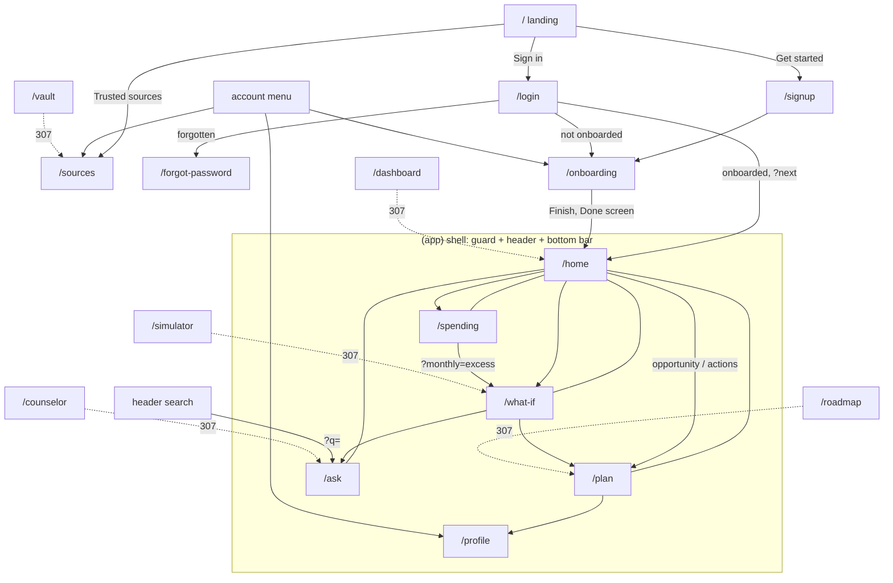
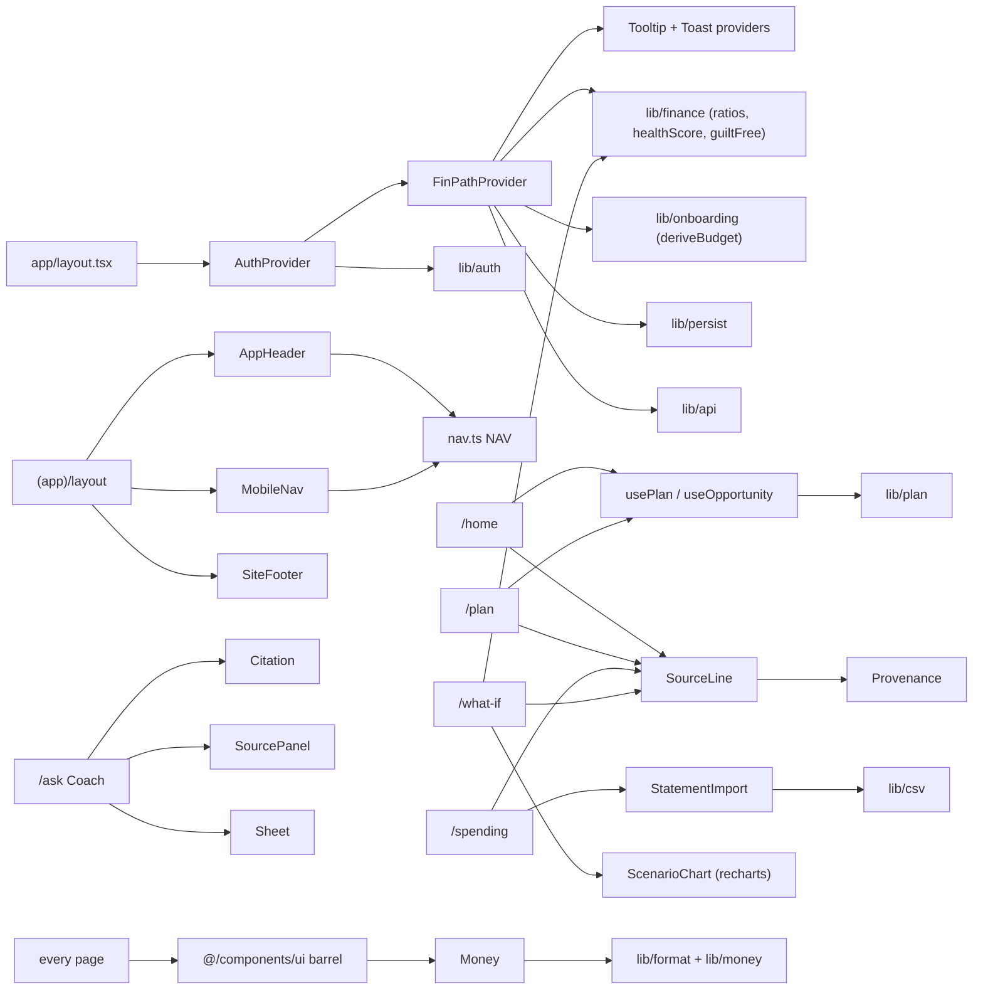
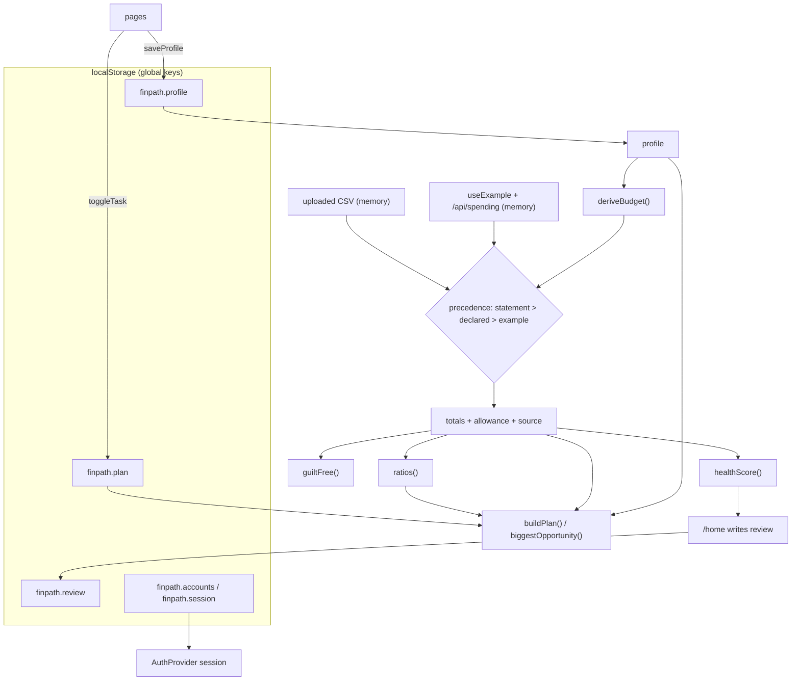
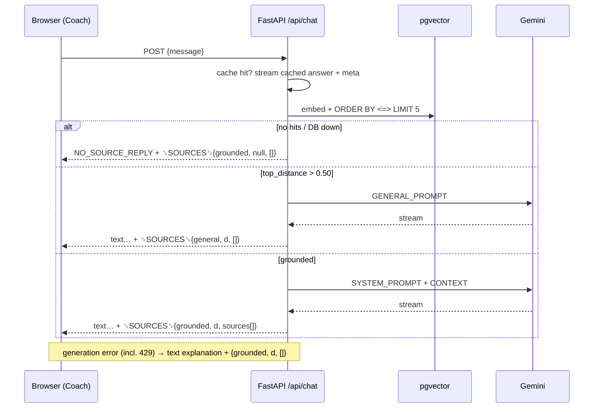

# Editorial UX refactor — Phase 1 audit

**Date:** 2026-09-27
**Branch:** `ux-refactor`, cut from `main` @ `c8e3d89`
**Scope:** I read every file in `frontend/app`, `frontend/components`, `frontend/lib`, `frontend/app/providers` and `frontend/scripts`. I read `backend/main.py` and `backend/nudge.py` only for their contracts. I changed no application code. The only file this phase adds is this one.

---

## 0. Baseline health (measured before any change)

| Gate | Result |
| --- | --- |
| `npm run typecheck` | 0 errors |
| `npm run design-lint` | passes. Baseline file is empty (`counts: {}`) |
| `npm run check-contrast` | passes, 15 tokens |
| `npm test` | **234 passed** in 4 files (`api` 8, `csv` 35, `format` 31, `golden` 21 `it` blocks) |
| `npm run build` | passes. 19 routes, all `○ Static` |

Next 16's build output no longer prints per-route sizes, so I measured them from the build itself. For each route I summed every `/_next/static/**/*.js` that its prerendered HTML references, raw and gzipped. The script lives in the session scratchpad. I'll use the same method again in Phase 11 so the before and after numbers compare like for like.

| Route | JS files | Raw kB | Gzip kB |
| --- | --- | --- | --- |
| `/` | 10 | 957.7 | 297.7 |
| `/ask` | 12 | 988.9 | 308.1 |
| `/forgot-password` | 11 | 979.6 | 304.3 |
| `/home` | 12 | 994.6 | 310.0 |
| `/login` | 11 | 980.1 | 304.6 |
| `/onboarding` | 11 | 986.2 | 306.2 |
| `/plan` | 12 | 992.1 | 309.2 |
| `/profile` | 12 | 989.9 | 307.9 |
| `/signup` | 11 | 980.3 | 304.7 |
| `/sources` | 11 | 984.2 | 305.9 |
| `/spending` | 12 | 1004.2 | 312.9 |
| `/styleguide` | 12 | 1012.8 | 314.0 |
| `/what-if` | 13 | 1336.0 | **406.8** |
| legacy redirects, `/_not-found` | 10 | 957.7 | 297.7 |

What stands out: every route, the landing page included, pays about **298 kB gzip** before it adds anything of its own. `/what-if` pays another ~100 kB for Recharts, which it imports statically. Section 11 covers both.

---

## 1. Route table

"Nav" means it appears in `NAV` (`app/components/nav.ts`), which the desktop header and the phone bottom bar both render.

| Route | File | Access | Data sources | What the user can do | Nav |
| --- | --- | --- | --- | --- | --- |
| `/` | `app/page.tsx` (server) + `PublicHeader` (client) | public | none. The preview is a labelled specimen | read the pitch; **Get started** → `/signup`; if signed in the header shows **Open FinPath** → `/home` | – |
| `/sources` | `app/sources/page.tsx` (client) | public | `GET /api/sources` | see the document library and whether each document is indexed; read how answers are built, the calculation rules (`#method`) and what FinPath won't do | footer, account menu |
| `/login` | `app/(auth)/login/{page,LoginForm}.tsx` | public | `AuthProvider` → `lib/auth.ts` | sign in; returns to `?next=`; a new user goes to `/onboarding` | – |
| `/signup` | `app/(auth)/signup/{page,SignupForm}.tsx` | public | `AuthProvider` | create a device-local account → `/onboarding` | – |
| `/forgot-password` | `app/(auth)/forgot-password/page.tsx` | public | `AuthProvider.requestPasswordReset` (a no-op in device mode) | request a reset; the device build explains honestly that no email is sent | – |
| `/onboarding` | `app/onboarding/page.tsx` (+ `AmountField.tsx`) | session only; its own guard | `FinPathProvider.profile` / `saveProfile` | 8 steps with running totals; Finish writes `completedAt` and shows a completion summary | account menu, footer |
| `/home` | `app/(app)/home/page.tsx` | session + onboarded | `useFinPath` (health, ratio, envelope, lastReview), `usePlan`, `useOpportunity` | score, breakdown, 3 key figures, biggest opportunity, next 3 actions, links to What-if and Spending | **Home** |
| `/spending` | `app/(app)/spending/{page,StatementImport}.tsx` | session + onboarded | `useFinPath` (totals, ratio, uploaded, income, uncategorised); `lib/csv.ts` in the browser | distribution, off-track list, recommended adjustment; import a CSV (parsed in the browser), place uncategorised rows, accept an allowance suggestion, read the method tab | **Spending** |
| `/plan` | `app/(app)/plan/page.tsx` | session + onboarded | `usePlan` (`lib/plan.ts`), `done` / `toggleTask` | 4-stage ladder; tick actions (persisted); read how each stage was measured and why the order is what it is | **Plan** |
| `/what-if` | `app/(app)/what-if/{page,ScenarioExplorer,ScenarioChart}.tsx` | session + onboarded | `useFinPath` (allowance, totals, params); `lib/finance.ts` series; `?monthly=` | 3 sliders + horizon; chart; 3-scenario comparison | **What-if** |
| `/ask` | `app/(app)/ask/{page,Coach}.tsx` | session + onboarded | `POST /api/chat` stream; `?q=` | ask (suggestions or free text); streamed answer with `[n]` citations; sources sheet; grounded/general badge; retry | **Ask** |
| `/profile` | `app/(app)/profile/page.tsx` | session + onboarded | `useAuth`, `useFinPath` profile | view account; edit every declared figure, goals and priority (draft, then Save/Discard); read data-storage notes; redo setup; sign out | account menu, footer |
| `/styleguide` | `app/styleguide/page.tsx` | public | reads tokens with `getComputedStyle` | review surface for tokens and every primitive | footer ("Design system") |
| `/dashboard` | `app/dashboard/page.tsx` | – | – | `redirect("/home")` | – |
| `/counselor` | `app/counselor/page.tsx` | – | – | `redirect("/ask")` | – |
| `/simulator` | `app/simulator/page.tsx` | – | – | `redirect("/what-if")` | – |
| `/roadmap` | `app/roadmap/page.tsx` | – | – | `redirect("/plan")` | – |
| `/vault` | `app/vault/page.tsx` | – | – | `redirect("/sources")` | – |
| 404 | `app/not-found.tsx` | public | – | links to `/home` and `/` | – |
| route error | `app/error.tsx` | – | – | Try again (`reset`), Go to Home | – |

---

## 2. Feature inventory (the acceptance checklist)

Each item has to stay reachable after the refactor. The Phase 14 report will tick every line and say where it lives.

**Public and trust**
1. Landing: explains the product, primary CTA to `/signup`, session-aware header (Sign in / Get started ↔ Open FinPath).
2. Landing: specimen preview, labelled "Illustration — a worked example, not real data".
3. Landing: how the health score is weighted (40 / 30 / 15 / 15).
4. `/sources`: live library from `/api/sources`, with loading, error + retry, and empty states.
5. `/sources`: "How an answer is put together", methodology rules (`#method` anchor), "What FinPath will not do".
6. The `DisclaimerNote` variants (advice / projection / example), wherever they're currently required.
7. Skip-to-content link on every shell.

**Accounts**
8. Sign up: name, email, a password of at least 10 characters that isn't digits only. Device-local, stored as a PBKDF2 verifier.
9. Sign in with `?next=` return and one generic failure message. A not-yet-onboarded user is routed to `/onboarding`.
10. Forgot password: never reveals whether an account exists; the device-mode honesty notice.
11. `DeviceAccountNote` on the auth screens, plus the note in the account menu.
12. Route guard: no session → `/login?next=`; not onboarded → `/onboarding`; waits for `status === "resolved"`.
13. Sign out (account menu and `/profile`).

**Onboarding**
14. Eight steps from `lib/onboarding.ts STEPS`, with the "Step X of 8" progress bar.
15. Running totals under each step (20% target, essentials share, lifestyle share, three months of cover, total owed).
16. Income is the only field that blocks progress, and it says why. Back keeps answers. "Leave for now" on step 1.
17. Focus moves to the step heading on each step change.
18. `completedAt` is written only on Finish, and the draft is never persisted per keystroke.
19. Completion summary (income / essentials / discretionary / set aside) with a link to Home or to upload a statement.

**Home**
20. Time-of-day greeting with the user's first name.
21. `SourceLine` provenance ("Based on: …") with its way out (upload a statement, or "use my own figures").
22. Health score dial, band word and band caption.
23. Score breakdown: savings / wants / needs meters against target, with points earned.
24. "Up/down N points since your last review", shown only when a real previous snapshot exists (`reviewStore`).
25. Money in; discretionary vs its target; guilt-free remaining plus per-day.
26. Biggest opportunity (`biggestOpportunity`): one finding with an amount and a link to where the fix lives.
27. Next best actions: the first 3 open plan actions, "N of M completed", link to `/plan`.
28. Long-term consequence block → `/what-if`, `/spending`, projection disclaimer.

**Spending**
29. Distribution bar plus a legend that doubles as the data table. Shares are of income. The Uncategorised slice appears only when non-zero.
30. "Money in" note for credits in an uploaded statement.
31. Off-track list (essentials / discretionary above target, savings below).
32. Recommended adjustment → `/what-if?monthly=<excess>` and `/plan`, or a "nothing needs cutting" state.
33. Statement import: drop zone / file picker, parsed in the browser, privacy note on the control, a toast with row counts.
34. "Try it with a sample file" (parses `SAMPLE_CSV` and shows the summary; see finding B-4).
35. Remove the uploaded statement.
36. File errors; the magnitudes-only explanation; the skipped-rows report.
37. Allowance suggestion from a recurring credit: accept (writes `monthlyIncome`) or dismiss.
38. "Rows waiting on you": place each uncategorised row. The full ledger has a per-row category select and show all / fewer.
39. "How this is calculated" tab.

**Plan**
40. Overall "actions completed" meter.
41. The 4-stage ladder, with exactly one stage marked "Now" and the rest Done / Later.
42. Per-stage progress, current/target amounts, and the `measure` sentence.
43. Tickable actions, persisted to `finpath.plan`, with a self-attested disclosure.
44. Invest stage → What-if link. "Why this order", your stated priority, and a link to change it.

**What-if**
45. Monthly amount, annual step-up and assumed return sliders; the horizon segmented control (10 / 20 / 30).
46. Opens on `?monthly=`, else on declared savings, else on 20% of income. The default rate comes from `projection_params`.
47. Projection chart inside `ChartFrame`, with the insight line, the assumptions line and a screen-reader data table.
48. Three-scenario comparison, the step-up gain and delay cost sentence, CTAs to Plan and Ask.

**Ask (AI)**
49. Suggested questions when the thread is empty.
50. Streamed answer, parsed against the `␟SOURCES␟` contract (object tail, or a bare array for compatibility).
51. Inline `[n]` markers render as `Citation` buttons. A marker with no matching source stays plain text.
52. Source chips plus "View sources" → a `SourcePanel` sheet: verbatim snippet, page, and "not stated in the document" for missing dates.
53. Grounded badge with the source count; general badge "Not from a verified source" plus `UnverifiedNote`.
54. Error state with the described failure (including the 429 rate-limit text) and "Ask again".
55. `?q=` from the header search asks automatically, once.
56. Enter sends, Shift+Enter adds a new line. `aria-live="polite"` region.
57. "About these answers" rail with a link to `/sources`. The disclaimer under the composer.

**Profile**
58. Account block (name, email, figures last updated).
59. Edit income, age, essentials, lifestyle, savings, emergency fund, debts (with running totals and the buffer target).
60. Goals (many), priority (one).
61. The draft is kept locally until Save; there's also Discard.
62. "Your data and this account" storage notes (device mode vs backend mode).
63. Links: Sources, Redo setup.

**Chrome and system**
64. App header: nav, the "Ask a question…" field (≥ lg), account menu (Profile, Update figures, Sources, device note, Sign out).
65. Phone bottom bar with the same items.
66. Site footer (three link groups, disclaimer, the no-products sentence).
67. Legacy redirects ×5.
68. 404 page; route error boundary with a digest reference.
69. Toasts (statement read, income updated, profile saved).
70. `/styleguide`.
71. The **example month** data source (`source: "example"`, opt-in). The provider still supports it, but nothing in the UI turns it on (see B-5).

**Engines with no UI today** (not a regression of this refactor; they were already unreachable at `c8e3d89`): `lifestyleCreep` (FI age), `runway` + `SHOCKS` (stress test), `HABITS`, `equivalents` / `REFERENCE`, `tags.isImpulse`. They stay in `lib/`, untouched. Whether any of them should come back to a screen is your call (Q13).

---

## 3. Duplicate and legacy routes

| Path | Status | Evidence | Proposal |
| --- | --- | --- | --- |
| `/dashboard` → `/home` | legacy | 6-line `redirect()` | **Keep as redirect** |
| `/counselor` → `/ask` | legacy | `redirect()` | **Keep as redirect** |
| `/simulator` → `/what-if` | legacy | `redirect()` | **Keep as redirect** |
| `/roadmap` → `/plan` | legacy | `redirect()` | **Keep as redirect** |
| `/vault` → `/sources` | legacy | `redirect()` | **Keep as redirect** |

There are no live duplicates. Each legacy path is a pure redirect with no UI of its own. One detail: the comments call these "permanent redirects", but `redirect()` in a server component sends **307**. `permanentRedirect()` would send 308. I'd switch them in Phase 11 (a one-word change that makes the code match its comment) unless you'd rather keep them temporary.

The brief's nav would make **Actions** the label for `/plan`. I propose keeping the URL `/plan`, since renaming it would add a sixth redirect for no user benefit, and changing only the label and page title.

---

## 4. Flows

### 4.1 Authentication (`AuthProvider`, `lib/auth.ts`)
- `createAuth(API)` picks `createDeviceAuth()` by default, or `createHttpAuth()` when `NEXT_PUBLIC_AUTH_MODE=backend`. The backend has no `/api/auth/*` routes, so device mode is what actually runs.
- Device mode: accounts live in `localStorage["finpath.accounts"]` (salt + PBKDF2-SHA-256 verifier, 210k iterations); the session lives in `localStorage["finpath.session"]`. Sign-in does the same derivation work whether or not the email exists.
- `status` is three-valued (`loading` → `resolved`). The `(app)` layout guard and the onboarding guard both wait for `resolved`.
- There's no "change password", "change name" or "delete account" in the adapter contract. That matters for the Phase 9 Security section (Q11).

### 4.2 Onboarding (`lib/onboarding.ts`)
- `STEPS` (8) is frozen: welcome, income, essentials (5 fields), lifestyle (5), savings (2), debt (4), goals (6 choices), priorities (3 radios).
- The draft is local and re-seeded from the stored profile when its identity changes. Finish → `saveProfile({...draft, completedAt})` → `isComplete()` becomes true → the route guard lets you in.
- `deriveBudget()` maps essentials → Needs, lifestyle → Wants, `monthlySavings` → Savings, `Uncategorised: 0`. Debt is not a bucket.

### 4.3 State (`FinPathProvider`, `lib/persist.ts`)
- Persisted through `useSyncExternalStore` stores: `finpath.profile`, `finpath.plan` (ticked task ids), `finpath.review` (one health snapshot).
- In memory only: `uploaded` (parsed statement), `useExample`.
- Precedence: statement → declared → example (opt-in). `ratio`, `health` and `envelope` are memoised from the resolved `{totals, allowance}`.
- ⚠ **The persisted stores are not scoped per account.** The keys are global, so a second device account in the same browser inherits the first account's profile, plan ticks and review snapshot, and skips onboarding. The `layout.tsx` comment says "FinPath's own state is per-person", but the code doesn't do that. Fixing it means changing the store keys (UI-side, not `lib/` logic). Flagged as B-7 and asked in Q12.

### 4.4 API (`lib/api.ts` → backend)
| Call site | Request | Response used |
| --- | --- | --- |
| `FinPathProvider` (root, **every route**) | `GET /api/spending?allowance=<max(1000, income)>` | `projection_params` always; `totals` / `transactions` only when `useExample` |
| `sources/page.tsx` | `GET /api/sources` | `documents[] {file, bytes, chunks, indexed}` |
| `ask/Coach.tsx` | `POST /api/chat {message}`, 120 s timeout | `text/plain` stream: body, `\n␟SOURCES␟`, `{mode, top_distance, sources[{n, source, page, snippet}]}` |
| `lib/api.ts describeApiFailure` | `GET /health` probe on network failure | reachability only |
| `lib/auth.ts createHttpAuth` (inactive) | `/api/auth/session`, `sign-in`, `sign-up`, `sign-out`, `forgot-password` | – |

Backend facts that affect the UI (from `main.py`, read only):
- A generation failure, **including 429 rate limiting**, is **not** an HTTP error. It arrives inside the stream as answer text ("The counsellor could not generate an answer. The model provider is rate-limiting…", or "[The answer was cut short. …]"), followed by meta with `mode: "grounded"` and `sources: []`. The UI currently renders that as a normal answer with a "Grounded in no sources" badge (B-2).
- An empty retrieval or an unreachable DB streams `NO_SOURCE_REPLY` with `mode: "grounded"` and no sources.
- The API keeps an in-memory answer cache per normalised question, so repeating a suggestion returns instantly.
- **Only one document is indexed**: `backend/data/collegestudents.pdf`, developed by MCX / FTKMC under SEBI's IPEF advisory committee. The five RBI / NCFE / SEBI PDFs sit in `backend/data_hold/` and are not indexed (Q5).

---

## 5. Diagrams

### 5.1 Routes and navigation

### 5.2 Component dependencies

### 5.3 State flow

### 5.4 API flow

---

## 6. Component inventory (`components/ui`, 36 files, one barrel)

| Primitive | Used by (outside `/styleguide`) | Notes |
| --- | --- | --- |
| `Avatar` | AppHeader | `text-sm` / `text-base` size leak |
| `Badge`, `StatusDot` | Coach, sources · StatusDot: styleguide only | |
| `Button`, `ButtonLink`, `ButtonRow`, `buttonClass` | 9 / 12 / 5 files · `buttonClass` styleguide only | primary = **ink fill** (brief wants accent); no `ghost`, it's called `quiet` |
| `Card`, `CardHeader`, `CardBody`, `CardFooter` | **styleguide only** | pages hand-roll `border border-line px-4 py-4` blocks instead (list below) |
| `ChartFrame` | ScenarioExplorer | |
| `Checkbox`, `Choice` | plan · profile, onboarding | |
| `Citation`, `UnverifiedNote` | Coach | |
| `DisclaimerNote` | 9 files | |
| `DistributionBar` | spending | "Above target" in critical |
| `DropZone` | StatementImport | |
| `SiteFooter` | (app) layout, landing, sources, 404 | |
| `Header` | **styleguide only** | AppHeader and PublicHeader re-implement it; this is a duplicate |
| `SkipLink`, `Wordmark` | both headers, auth, onboarding | |
| `Insight`, `ActionCard` | home, spending · home | `ActionCard` **already exists** in `insight.tsx` with props `{n, title, why, action, selfAttested, done}` |
| `Input`, `BareInput` | auth forms, AmountField · BareInput styleguide only | Coach and AppHeader hand-roll inputs (duplicate `CONTROL` classes) |
| `MarginLayout`, `MarginNote`, `MarginBody`, `Annotated` | **styleguide only** | the "signature" gutter is used on no product screen |
| `Menu` family | AppHeader | |
| `Metric`, `MetricRow` | **styleguide only** | home, what-if, StatementImport and onboarding each hand-roll a `Figure` / `Scenario` / `ImportSummary` / `Running` block that duplicates `Metric` |
| `Modal`, `ModalClose` | styleguide only | |
| `Money` | 8 files | sizes use Tailwind `text-sm/base/2xl/4xl`, not type tokens |
| `PageHeader`, `Section` | 6 / 5 files | |
| `PasswordInput` | login, signup | |
| `ProgressMeter` | home, plan | bar turns critical when over target |
| `Provenance` | SourceLine | |
| `ScoreDial` | home, landing | number is `type-data text-6xl` (Inter) |
| `Segmented`, `Select`, `Slider`, `Stepper` | what-if · StatementImport · what-if · onboarding | Stepper is segmented ticks in ink, not an accent bar |
| `Sheet` | Coach | right side only. The brief wants a bottom sheet on mobile |
| `Sidebar`, `MobileNav` | styleguide only · (app) layout | MobileNav has no safe-area inset |
| `SourcePanel` | Coach | heading uses a raw `uppercase` instead of `type-eyebrow` |
| `EmptyState`, `ErrorState`, `LoadingState`, `Skeleton` | 2 / 2 / 7 files · Skeleton styleguide only | ErrorState is a red panel. The brief wants calm inline notes for chat errors |
| `Tabs` family, `Table` family | spending | `TRowHeader` styleguide only |
| `Timeline`, `TimelineStage` | plan | |
| `ToastProvider`, `useToast`, `Tooltip`, `TooltipProvider` | layout, profile, import · Tooltip styleguide only | |

**One-off styles in pages that duplicate a primitive:**
- Bordered blocks hand-rolled as `border border-line bg-surface px-4 py-4`: `DeviceAccountNote`, `AllowancePrompt`, `SkipReport`, landing `PreviewPanel`, plan action `<li>`, forgot-password notices. These should be `Card`.
- Alert panels hand-rolled as `border border-critical bg-critical-wash`: LoginForm, SignupForm, forgot-password (device notice), StatementImport file errors. They should be one primitive (a calm `Notice`), and most of them aren't critical by the brief's definition.
- Figure blocks (`dt` label / `Money` on `ledger-rule` / note): `home Figure`, `what-if Scenario`, `ImportSummary`, onboarding `Running`, `Done`. That's `Metric`.
- Text inputs: `Coach` textarea and the `AppHeader` search each copy `Input`'s control classes.
- Header chrome: `AppHeader`, `PublicHeader` and the onboarding header each re-implement `Header`.

---

## 7. Current visual inventory ("before")

### 7.1 Per route

| Route | What it looks like today | The user's next step |
| --- | --- | --- |
| `/` | Cool off-white page. A two-column hero: 76 px serif headline, a paragraph, ink-filled "Build my financial plan" button; on the right, a bordered grey specimen panel with the score dial and four ledger rows. Then five alternating white / grey bands: 3-step "how it works", score weights, a 4-card capabilities grid with icons, trusted sources (two buttons, one primary), final CTA (another primary). | Clear (sign up), but there are **four ink-filled primary buttons** on the page. |
| `/sources` | Public header; 52 px serif title; four sections separated by hairline-ruled serif headings: library list with badges, a numbered 4-step method, 5 rules, "will not do" list. | Unclear. Reference page with no CTA beyond "Ask a question anyway" in the empty state. |
| `/login`, `/signup`, `/forgot-password` | ≥1024 px: a grey left panel with a 52 px serif statement and three bordered-left bullets; the form on the right. Phones: form only. Ink primary button; grey device-account note box. | Clear (submit). |
| `/onboarding` | Own header ("Setting up X's FinPath"); an 8-segment ink tick bar with "STEP 3 OF 8"; 52 px serif question; stacked amount fields; running total on a hairline; Back + ink Continue; disclaimer. Finish → a separate "Your FinPath is ready" screen with a summary and two buttons. | Clear (Continue). The Done screen adds one click before Home. |
| `/home` | 52 px serif greeting + "Based on:" line; ScoreDial (accent arc, 60 px Inter number) beside three ProgressMeters; "Your month, in three numbers" 3-column figures; left-bordered Insight with a 36 px amount and an **ink primary** button; three grey ActionCards; "Where this goes over time" paragraph with **another primary** button. About 5 screens tall on a phone. | Unclear on a phone. The opportunity CTA sits around the third screenful, below the dial, the meters and the figures, and there are 2 primary buttons. |
| `/spending` | Title + provenance; grey distribution bar in four ink tints with a legend; off-track list; red-bordered Insight "Recommended adjustment" with a 36 px amount; tabs "Statement" (dashed drop zone, sample and remove buttons, ledger table) and "How this is calculated". | Mostly clear ("See what it becomes"). Uploading, the single most useful action for a declared-only user, is hidden behind the tab at the bottom. |
| `/plan` | Title, provenance, actions meter; vertical timeline with a square numbered rail, serif stage titles, Now/Done/Later eyebrows, per-stage meter, bordered checkbox items; "Why this order" block. | Clear-ish. The "Now" stage is marked, but every stage is fully expanded. |
| `/what-if` | Title + provenance; a two-column layout with three sliders + segmented control on the left and a Recharts line chart (accent / ink / dashed) on the right; three figures with the middle one larger; explanatory sentence; ink primary "Set this up in my plan". | Clear. |
| `/ask` | 52 px serif title + purpose; the empty state is a serif "Not sure where to start?" with five ruled suggestion rows; right rail (≥ lg) "About these answers"; sticky composer with a 2-row textarea and an ink square send button; the disclaimer under it. Answers: the question as a 24 px serif heading, then a badge (green check "Grounded in N sources", or red triangle "Not from a verified source"), then plain text, then chips. The sources sheet slides in from the right. | Clear (ask). No Stop button. |
| `/profile` | Title with a Save button that appears only when dirty; seven ruled sections of 2-column amount grids; data notes; buttons including a red "Sign out". | Unclear. There's no single task; the long form reads as settings. |
| `/styleguide` | Every token (read live) and primitive, in 30 sections. | n/a (review surface) |
| 404, error | Serif statement plus two buttons (one primary). | Clear. |

### 7.2 Token values today

**Colour (15)**

| Token | Value | Role |
| --- | --- | --- |
| `--color-canvas` | `#fcfcfb` | page |
| `--color-surface` | `#f6f6f4` | panels |
| `--color-surface-sunken` | `#efefec` | wells, inputs, user turn |
| `--color-ink` | `#2a2a2e` | primary text, primary-button fill |
| `--color-ink-secondary` | `#5a5a62` | supporting text |
| `--color-ink-muted` | `#64646c` | labels, captions |
| `--color-ink-disabled` | `#a8a8ae` | disabled only |
| `--color-line` | `#e4e4e0` | hairlines, card edges |
| `--color-line-strong` | `#2a2a2e` | control borders, **focus ring** |
| `--color-accent` | `#1f5f4f` | used in exactly 6 places: 4 text links (auth ×3, landing), the score arc, the step-up chart line |
| `--color-accent-wash` | `#eef3f1` | unused on product screens |
| `--color-critical` / `-wash` | `#a34a45` / `#f7efee` | fired rules, errors |
| `--color-positive` / `-wash` | `#4c5d50` / `#f0f2ef` | done, grounded |

**Type**

| Role | Family / weight | Size / line-height |
| --- | --- | --- |
| `type-hero` | Instrument Serif 400 | clamp 44→76 px / 1.04 |
| `type-display` | Instrument Serif 400 | clamp 36→52 px / 1.1 |
| `type-heading` | Instrument Serif 400 | 24 / 1.25 |
| `type-subhead` | Inter 600 | 16 / 1.4 |
| `type-body` | Inter 400 | **15** / 1.6 |
| `type-label` | Inter 500 | 13 / 1.4 |
| `type-eyebrow` | Inter 600, uppercase, +0.1em | **11** / 1.3 |
| `type-data` | Inter 500, `tnum` | inherits |
| `Money` sizes (not tokens) | Inter via `type-data` | sm 14 · md 16 · lg 24 · xl 36 |
| `ScoreDial` number (not a token) | Inter | 60 (`text-6xl`) |

**Layout and motion:** `--container-page 1200px`, `--container-prose 68ch`, `--container-form 420px`, `--width-gutter 160px` (the margin grid switches on at **1024 px**), `--ease-out cubic-bezier(.16,1,.3,1)`, `--dur-fast 120ms`, `--dur-base 200ms`. All radius tokens are 0 and all shadow tokens are neutralised.

---

## 8. Style leaks

design-lint passes, and there are **no raw hex values, no default-palette classes (`text-gray-*` etc.) and no arbitrary colours or font sizes** anywhere outside `globals.css`. The leaks that remain are the kinds the linter doesn't catch.

**Default Tailwind font sizes used as type (bypassing the role system):**

| File | Classes |
| --- | --- |
| `components/ui/money.tsx` | `text-sm`, `text-base`, `text-2xl`, `text-4xl` (the Money size scale) |
| `components/ui/metric.tsx` | `text-base`, `text-2xl`, `text-4xl` |
| `components/ui/score-dial.tsx` | `text-6xl` |
| `components/ui/slider.tsx` | `text-base`, `text-sm` ×2 |
| `components/ui/avatar.tsx` | `text-sm`, `text-base` |
| `components/ui/citation.tsx`, `insight.tsx`, `progress-meter.tsx`, `timeline.tsx`, `distribution.tsx` ×2, `source-panel.tsx` ×2 | `text-sm` |
| `app/page.tsx` | `text-lg` (hero paragraph), `text-sm` |
| `app/(app)/spending/StatementImport.tsx` | `text-2xl`, `text-sm` ×2 |
| `app/(app)/what-if/ScenarioChart.tsx` | `text-sm` |
| `app/sources/page.tsx` | `text-sm` |
| `app/styleguide/page.tsx` | `text-sm` ×9 |

**Arbitrary (`[…]`) values**, none of them colours or sizes: `sheet.tsx` `max-h-[85dvh]`, `w-[calc(100vw-3rem)]`, `transition-[opacity,translate]`; `modal.tsx` `w-[calc(100vw-2rem)]`, `max-h-[calc(100dvh-4rem)]`; `select.tsx` `grid-cols-[1rem_1fr]`; `choice.tsx` `has-[:focus-visible]` ×3; page grids `lg:grid-cols-[…]` in `page.tsx`, `home`, `what-if`, `Coach`.

**Inline `style`:** `distribution.tsx` (segment widths), `progress-meter.tsx` (fill width, target position), `score-dial.tsx` (`width: 240`), `styleguide` (swatches, chart bars). All are data-driven geometry, which is legitimate.

**Literal visual values in JS props:** `ScenarioChart.tsx` `fontSize: 12`, `strokeWidth` 1/2, `strokeDasharray="4 4"`; `score-dial.tsx` `STROKE = 14`. Colours there are already `var(--color-*)`.

**Other:** opacity modifiers `bg-critical/90` (button), `bg-ink/20` (modal and sheet backdrops); raw `uppercase` in `source-panel.tsx` (should be `type-eyebrow`); font-weight overrides `font-semibold` for active states (AppHeader, Segmented, Sidebar, Tabs) and `font-medium` / `font-normal` (table).

The Phase 2 remap fixes the "cool grey" look everywhere at once, because every surface already goes through tokens. The only thing it won't reach is the font-size leaks above, which Phase 2 will route through the new scale.

---

## 9. Health score

**A health score already exists.** No new formula is needed.

`lib/finance.ts → healthScore(totals, allowance)`, frozen and covered by `golden-503020.json`:

| Part | Points | Plain sentence |
| --- | --- | --- |
| Savings rate | 40 | Full marks when you set aside at least 20% of your income, falling in a straight line to zero at nothing saved. |
| Discretionary control | 30 | Full marks when wants stay at or under 30% of income, falling to zero at 60%. |
| Essentials control | 15 | Full marks when essentials stay at or under 50% of income, falling to zero at 100%. |
| Unspent buffer | 15 | Full marks when at least 10% of income is left after everything, uncategorised spending included. |

Bands: ≥ 80 Strong · ≥ 60 Stable · ≥ 40 Strained · otherwise At risk. It returns `{score, band, parts}`.

For Phase 6's "one line naming what drives it", I propose one new pure function (additive, with its own tests plus a golden fixture), `scoreDriver(health)`. It returns the part with the largest shortfall from its maximum, as a key plus the points missing, and the page words it ("Savings is the biggest drag: 18 of 40 points"). It reads only `health.parts`, which already exists.

The `/landing` copy and `/sources#method` already document this formula, and both stay true.

---

## 10. Conflicts

Where this brief overrides an earlier decision. The brief wins unless you say otherwise, but each needs your confirmation.

| # | Brief says | Existing source says | Proposed resolution |
| --- | --- | --- | --- |
| C-1 | Nav: Home · Actions · AI · Profile | `nav.ts` + `CLAUDE.md`: five items, Home/Spending/Plan/What-if/Ask; "five is the ceiling" | Go to four and rewrite the rationale comment. Spending and What-if reached from Home and Actions. |
| C-2 | Hero figures (big rupee numbers, score) in Instrument Serif | `globals.css` type roles: "Serif … never appears in … a number"; `CLAUDE.md`: `type-data` for EVERY numeral; `layout.tsx` comment | New role `type-figure`: serif, for **one standalone hero figure per block only**, never in a column or table. `type-data` stays for everything else. (Q1) |
| C-3 | Accent = primary action, progress, links, focus ring | `globals.css`: accent "never … any surface larger than a control, any heading, any amount"; primary button is ink fill; focus ring is `line-strong`; `check-contrast` asserts "canvas on ink (primary button)" | Primary button becomes an accent fill, and the focus ring becomes accent (6.06:1 on the sunken ground, so it passes 1.4.11). Add a `check-contrast` case for the accent focus ring on every ground. Selected controls (checkbox, segment) stay ink, since the brief doesn't list them. |
| C-4 | Critical only for real problems; overspending is information | `lib/plan.ts biggestOpportunity` returns `tone: "critical"` for wants excess (frozen); `ProgressMeter` fills critical when over; `DistributionBar` "Above target" in critical; spending Insight `tone="critical"`; Coach "Not from a verified source" uses `Badge tone="critical"` | Leave `lib/` alone and map at the view layer: wants excess shows ink plus a sentence, and critical is kept for debt and errors. The general-mode badge becomes a neutral text label with a glyph ("Not from a verified source"). (Q2) |
| C-5 | Body ≥ 16 px; long reading 17 px / ~1.6 | `type-body` is 15 px | `type-body` → 16 px; add a `type-reading` role at 17 px / 1.6 for answers and explanations. |
| C-6 | Section labels: small uppercase Inter | `type-eyebrow` is 11 px; design-plan §14 says "no text below 12px" | `type-eyebrow` → 12 px. This fixes an existing contradiction too. |
| C-7 | "At most three text sizes per screen" | Eight roles, and pages mix five or six today | Enforce by composition per screen (not by linter), checked in Phase 13. |
| C-8 | Margin notes in the gutter at ≥ 1280 px | `margin-layout` switches at 1024 px (`64rem`); design-plan §6 says 1024 | Move the breakpoint to 1280 px (`80rem`). Only the styleguide uses it today. |
| C-9 | Chat: single centred prose column, composer fixed to the bottom, citations as margin notes at ≥ 1280 | design-plan §12: two columns with a persistent source panel; Coach comment: "NOT A CHATGPT CLONE" | Follow the brief and rewrite the Coach header comment. The inspector becomes a side panel (≥ 1280) or a bottom sheet (< 1280). |
| C-10 | Landing: "keep the inline diagnostic (₹3,500 → ₹10,870)" | **It doesn't exist.** It was removed in the rebuild (design-plan §16: `/` has zero client JS; audit F-04: it duplicated the rate constants). Only the README still describes it. | Rebuild it as a small client island from `lumpSumFutureValue` with the rate from `projection_params` (3,500 × 1.12¹⁰ = ₹10,870). (Q3) |
| C-11 | Onboarding: "one or two questions per step" | `STEPS` (frozen in `lib/`) has 8 steps; essentials and lifestyle carry five amount fields each | Treat each step's heading as its one question and keep the 8 steps and all fields. (Q4) |
| C-12 | Onboarding finish leads straight to Home | The "Your FinPath is ready" Done screen with its summary | Drop the Done screen; Home's greeting sentence carries the summary. |
| C-13 | Desktop header: wordmark, nav, profile menu | AppHeader also has the "Ask a question…" field (≥ lg), documented as the one honest "search" | Remove it from the header; Home's AI entry replaces it. (Q6) |
| C-14 | Profile: Personal, Income, Goals, Security, each with Edit / Save / Cancel | Profile edits everything at once with one draft; it also holds essentials, lifestyle, savings, debts and priority | Four blocks, mapping in Q11. No field disappears. |
| C-15 | Trust line: "answers come from RBI, SEBI and NCFE publications" | Only `collegestudents.pdf` (SEBI IPEF-guided) is indexed; the RBI / NCFE PDFs sit un-ingested in `data_hold/` | The copy has to be true of what's indexed. (Q5) |
| C-16 | Chat empty state: four suggested prompts from topics the corpus covers | The current five include "expense ratio" (0 mentions in the corpus), UPI (1) and KYC (1), which likely fall to the general path | Replace them with corpus topics: power of compounding, inflation vs investments, SMART goals, savings vs investment, credit cards and loans, grievance redressal. |
| C-17 | `ActionCard` in a new `components/ui/action-card.tsx` with `priority` and `estimatedMinutes` | `ActionCard` already lives in `insight.tsx` with different props; plan actions carry neither field | Move it to its own file with the new props; `Insight` stays. (Q7) |
| C-18 | Buttons: primary / secondary / **ghost** | Variants are primary / secondary / **quiet** / critical | Rename `quiet` → `ghost` (3 call sites plus the styleguide); keep `critical`. |

---

## 11. Implementation plan

Each phase ends with `npm run verify`, one commit `ux(phase-N): …`, and a report with "Where to see it". I'll check each affected route at 375 and 1280 px with the browser tool if the extension is connected; if it isn't, I'll say so.

**Phase 2: visual foundation**
- `app/globals.css`: remap the 15 colour tokens to the warm palette (values below, pre-checked); redefine `type-body` (16), `type-eyebrow` (12); add `type-reading` (17/1.6) and `type-figure` (serif hero figure); add a Money size scale as tokens; focus ring → accent; `margin-layout` → 80rem; update every explanatory comment.
- `scripts/check-contrast.mjs`: replace "canvas on ink (primary button)" with "canvas on accent (primary button)"; add accent as a focus ring on all grounds. The palette stays at 15.
- Route the leaks through roles: `money.tsx`, `metric.tsx`, `score-dial.tsx`, `slider.tsx`, `avatar.tsx`, `citation.tsx`, `insight.tsx`, `progress-meter.tsx`, `timeline.tsx`, `distribution.tsx`, `source-panel.tsx`, `StatementImport.tsx`, `ScenarioChart.tsx`, `page.tsx`, `sources/page.tsx`.
- `button.tsx`: primary becomes an accent fill.
- `app/styleguide/page.tsx`: new palette, type roles and scale.

Proposed warm palette, run through the exact `check-contrast` pairings. **All pass.**

| Token | Before | After | Key ratio |
| --- | --- | --- | --- |
| canvas | `#fcfcfb` | `#FAF7F0` | – |
| surface | `#f6f6f4` | `#F4F0E6` | – |
| surface-sunken | `#efefec` | `#ECE7DB` | – |
| ink | `#2a2a2e` | `#1C1B19` | 16.09 on canvas |
| ink-secondary | `#5a5a62` | `#4F4B44` | 7.03 on sunken |
| ink-muted | `#64646c` | `#5E5A52` | 5.56 on sunken |
| ink-disabled | `#a8a8ae` | `#A8A298` | 2.37 (must stay < 4.5) |
| line | `#e4e4e0` | `#E4DED1` | 1.25 (must stay < 3) |
| line-strong | `#2a2a2e` | `#1C1B19` | 13.95 on sunken |
| accent | `#1f5f4f` | unchanged | 6.99 canvas · 6.06 sunken |
| accent-wash | `#eef3f1` | `#EAF0E8` | accent on it 6.46 |
| critical | `#a34a45` | unchanged | 4.70 on sunken (tightest) |
| critical-wash | `#f7efee` | `#F6ECE6` | critical on it 4.98 |
| positive | `#4c5d50` | unchanged | 5.69 on sunken |
| positive-wash | `#f0f2ef` | `#EDEFE6` | positive on it 6.05 |

**Phase 3: navigation.** `nav.ts` (4 items plus rationale); `AppHeader.tsx` (slim, no search, aria-current with an underline bar); `sidebar.tsx MobileNav` (44 × 44, labels under icons, `env(safe-area-inset-bottom)` via a new utility in `globals.css`); `footer.tsx` link groups; secondary links to Spending and What-if on `/home` and `/plan`.

**Phase 4: landing.** Rewrite `app/page.tsx` as a server component: hero, one CTA, trust line, and the diagnostic island `app/components/Diagnostic.tsx` (client, `lumpSumFutureValue` + params). Remove the specimen, steps, weights and capabilities sections (their content already lives on `/sources`). `PublicHeader` keeps its session-aware single CTA.

**Phase 5: onboarding.** `app/onboarding/page.tsx`: wrap each step in a `<form>` so Enter advances; add inline validation on blur and on Next for income ("Enter your monthly income in rupees"); rebuild `Stepper` as "Step X of N" plus a thin accent bar; Finish → `router.replace("/home")`. No `lib/onboarding.ts` change.

**Phase 6: Home.** Rewrite `app/(app)/home/page.tsx`: greeting and summary sentence → `ScoreDial` + driver line → top 3 `ActionCard`s → 3 progress figures → AI entry (`/ask?q=`) → secondary links. Add `lib/score.ts scoreDriver()` with `score.test.ts` and `__fixtures__/golden-score-driver.json`. Empty states: brand-new (can't reach Home without onboarding, so this is the declared-only state) and "no spending data" → "Import a statement or use an example month".

**Phase 7: ActionCard.** New `components/ui/action-card.tsx` plus a barrel export; `lib/action-meta.ts` (typed config: `estimatedMinutes` and `href` per plan action id, see Q7); remove `ActionCard` from `insight.tsx`; use it on `/home` and `/plan` (plan stages render their actions as cards with done state), and for the Spending recommendation.

**Phase 8: AI chat.** Rewrite the layout of `app/(app)/ask/Coach.tsx`: prose column, fixed composer, user turn on `surface-sunken` aligned right, answers in `type-reading`, mode label above each answer, Stop via `reader.cancel()` (no `lib/api.ts` change), partial answer kept on failure, a failure or 429 detected from the stream text and shown as a calm inline note, margin-note sources at ≥ 1280, a compact list below that, `Sheet` gains responsive side (right ≥ 1280, bottom < 1280), and new suggestions. The stream parser and `␟SOURCES␟` handling don't change.

**Phase 9: Profile.** `app/(app)/profile/page.tsx` → four `Card` blocks with per-block Edit / Save / Cancel over the same `saveProfile`.

**Phase 10: standardisation.** Add `Notice` (calm inline note: neutral / critical) to replace the six hand-rolled alert panels; move hand-rolled bordered blocks to `Card` and figure blocks to `Metric`; Coach and the header use `BareInput`; `quiet` → `ghost`; styleguide shows every variant.

**Phase 11: performance.** Re-measure with the same script. Candidates: lazy `ScenarioChart` via `next/dynamic`; stop fetching `/api/spending` on public and auth routes (move the fetch behind first use of `params` / example, or scope it to the `(app)` shell); investigate the ~298 kB shared baseline (suspects: the root layout importing the whole `@/components/ui` barrel for two providers, and Base UI); `permanentRedirect` on the legacy routes. Deletion candidates, pending proof of non-use: `lib/categories.ts` (references `--color-data-*`, `ink-faint` and `rule-strong` tokens that **no longer exist**; imported nowhere). **Unused npm dependencies:** `motion`, `tw-animate-css`, `class-variance-authority`, `shadcn`. Removing them changes `package.json`, so I'll ask first.

**Phase 12: accessibility.** Accent focus ring (from Phase 2); keyboard walkthrough documented in `docs/refactor/a11y-walkthrough.md`; audit `aria-label` on icon buttons; 44 px targets (the Modal close is currently 24 px).

**Phases 13–14:** as specified.

### Bugs found along the way

These are UI-side and fixable without touching `lib/` behaviour. I'll fix them in the phase that owns the screen unless you object.

| ID | Where | Bug |
| --- | --- | --- |
| B-1 | `ScenarioChart.tsx` tooltip | Hard-codes "Rising 10% a year" whatever the step-up slider says. |
| B-2 | `Coach.tsx` | A generation failure or 429 renders as a normal answer with a "Grounded in no sources" badge. |
| B-3 | `Coach.tsx` | A transport error replaces the partial answer with an ErrorState, so text already streamed disappears. design-plan §12 says it must be kept. |
| B-4 | `StatementImport.tsx` | "Try it with a sample file" parses and shows the summary but doesn't load anything, so none of the page changes. It reads like it's broken. |
| B-5 | provider / UI | The "example month" source has no opt-in anywhere (`setUseExample(true)` is never called), yet `/api/spending` is fetched on every route, landing and auth included. |
| B-6 | legacy routes | The comments say permanent; they send 307. |
| B-7 | `FinPathProvider` | Profile, plan ticks and review are global `localStorage` keys, not per account (§4.3). |
| B-8 | `LoginForm` → signup link | Carries `?next=`, but `SignupForm` ignores it. After onboarding, the user lands on `/home` instead of where they were going. |

---

## Open questions (Phase 2 can't start until these are answered)

Each question has a recommendation. "Approve all recommendations" is a valid answer.

1. **Serif hero figures (C-2).** Add `type-figure` (Instrument Serif) for one standalone hero figure per block: the score number, the landing diagnostic result, and the one big amount in a card. `type-data` (Inter tabular) stays for every other numeral. *Recommended: yes.*
2. **Overspending tone (C-4).** Show wants excess in ink with a sentence, and keep critical for debt, errors and parse failures. The general-mode chat label becomes neutral text plus a glyph instead of a red badge. `lib/plan.ts` stays untouched; this is a view-layer mapping. *Recommended: yes.*
3. **Landing diagnostic (C-10).** Rebuild it: an editable amount prefilled with 3,500 and labelled as an example, the result from `lumpSumFutureValue` at the API's rate, and the source ("12% a year, 10 years, illustrative") as a margin note. That puts a small client island on `/`. *Recommended: rebuild. The alternative is to drop it and fix the README.*
4. **Onboarding step granularity (C-11).** Keep the 8 frozen steps, with the step heading as the one question. The alternative is splitting the 5-field steps into UI sub-steps, which gives 12+ screens. *Recommended: keep 8.*
5. **Trust line and corpus (C-15).** Only the SEBI-IPEF-guided college booklet is indexed. Options: (a) accurate copy now, e.g. "Answers come from financial-education publications made under SEBI's investor-education programme, and FinPath sells nothing", switching to "RBI, SEBI and NCFE" once you run `ingest.py` on `data_hold/` (backend work is out of my scope); (b) you ingest first and I keep the RBI / SEBI / NCFE wording. *Recommended: (a). I'd also suggest you ingest `data_hold/` and re-run `probe_threshold.py` at some point.*
6. **Header search and AI entry (C-13).** Remove the header "Ask a question…" field. Home's AI input opens `/ask?q=…` **prefilled but not sent**, so the student presses Enter to send. Today `?q=` sends automatically. *Recommended: prefill only.*
7. **ActionCard data (C-17).** Neither `priority` nor `estimatedMinutes` has a data source.
   - `priority`: derive it from the plan, not a new value. Actions in the stage marked "attention" are **high**, the next stage **medium**, later stages **low**.
   - `estimatedMinutes`: one typed config, `lib/action-meta.ts`, keyed by the 8 plan action ids. Draft values for your approval: debt-clear 10, debt-later 15, buffer-account 20, buffer-fund 5, invest-sip 20, invest-wants 10, wealth-stepup 5, wealth-review 30. The same file holds each card's destination `href`.
   - *Recommended: approve the derivation, and edit the minute values as you see fit.*
8. **Nav labels (C-1).** "AI" as the nav label for `/ask`, and "Actions" for `/plan`, with `/plan`'s page title also becoming "Your actions". The URL stays `/plan`. *Recommended: yes. If you'd rather, "Ask" is closer to the old voice rule than "AI".*
9. **Example month (B-5).** Restore a visible opt-in, "Use an example month" in the Spending / Home empty state, always labelled by `SourceLine`. That's the brief's "use sample data". "Try it with a sample file" (B-4) would then load the sample CSV as a labelled example rather than only previewing it. *Recommended: yes to both.*
10. **Sample CSV source label.** If the sample CSV is loaded (Q9), it would show as "Your uploaded statement", which isn't true. Adding a fourth `SOURCE_LABEL` ("A sample statement") changes `FinPathProvider`, not `lib/`. *Recommended: add the label.*
11. **Profile mapping (C-14).** Personal = name and email (read-only; the auth contract has no update call) plus age. Income = monthly income, essentials, lifestyle, monthly savings, emergency balance, debts. Goals = goals plus priority. Security = where data lives, the password note, sign out and redo setup. Security has **no editable fields** because device-mode auth has no change-password. I'll show only what's true there and invent nothing. *Recommended: yes.*
12. **Per-account state (B-7).** Scope `finpath.profile` / `plan` / `review` by `session.userId`. It fixes a real privacy leak between accounts in one browser, but it's a behaviour change in `FinPathProvider`, and existing stored figures would need a one-time migration to the current user. *Recommended: fix it in Phase 9, with migration. Or defer it as out of scope.*
13. **Engines with no UI** (FI age, stress test, habits, equivalents). They're not reachable today. *Recommended: leave them unsurfaced in this refactor and note it in `MIGRATION.md`.*
14. **Unused dependencies** (`motion`, `tw-animate-css`, `class-variance-authority`, `shadcn`). *Recommended: remove them in Phase 11.* That's a removal, not an addition, but it touches `package.json`, so I'm asking.

---

## Decisions (2026-09-27)

All recommendations approved, with these amendments:

- **Q8:** `/ask` is labelled **Ask** (a verb, per the `nav.ts` rule on student-facing labels), not "AI". `/plan` is labelled **Actions**, URL unchanged.
- **Q7:** approved. `lib/action-meta.ts` opens with a DRAFT comment: the minute values await the owner's review before merge.
- **Q11:** Security is factual only (where the account and data are stored, sign out). It has no Edit button.
- **Q12:** approved, with tests for per-account storage and the one-time migration, documented in `MIGRATION.md`.
- **Q14:** approved. The Phase 11 report names the four packages and confirms the build after removal.
- **Bugs B-1 to B-8:** each is fixed in the phase that already touches its files. Any that don't fit a phase are listed in that phase's report, not skipped.
