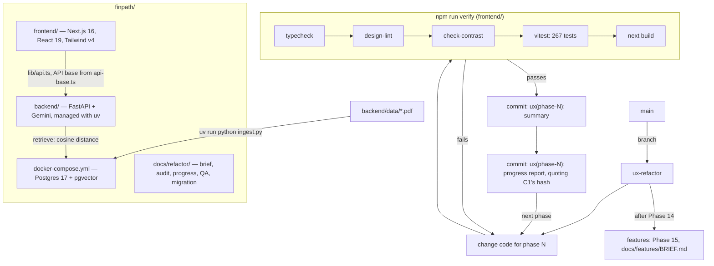
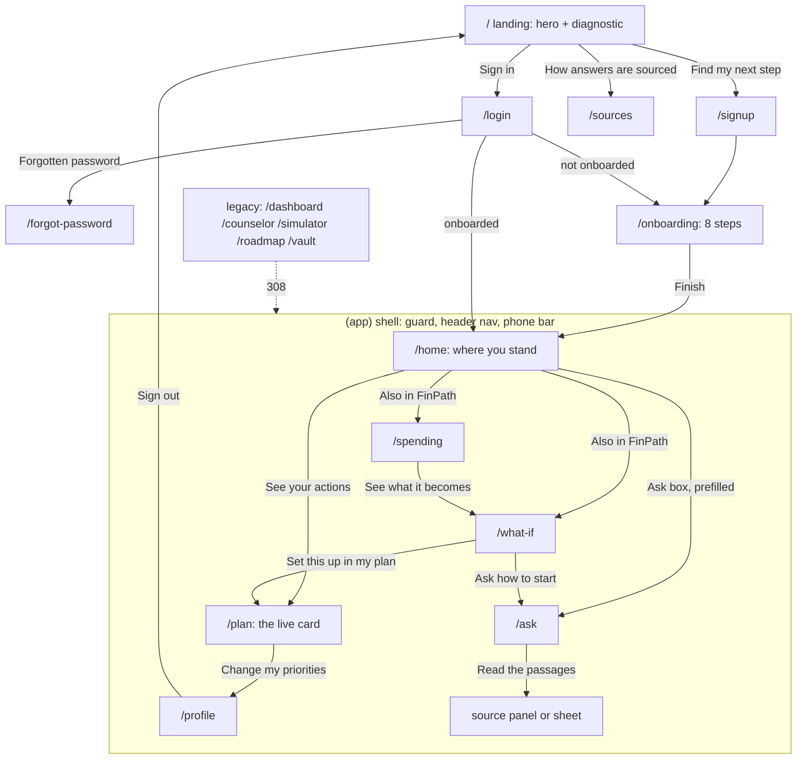
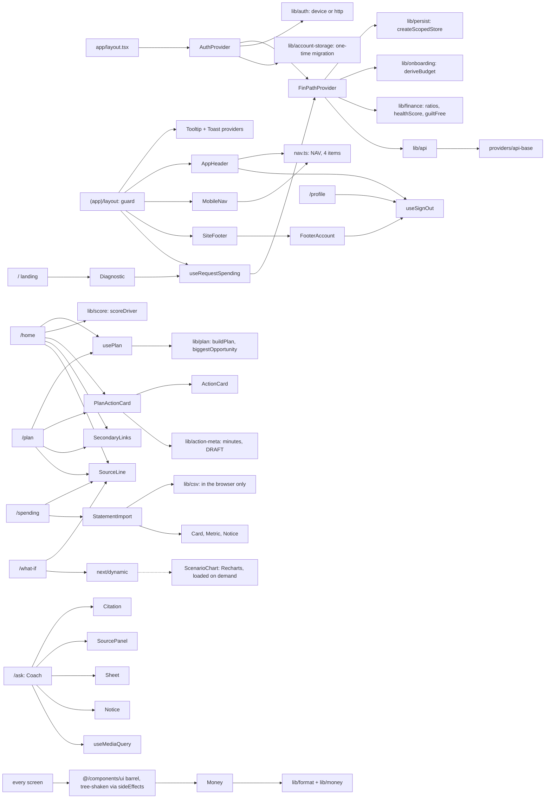
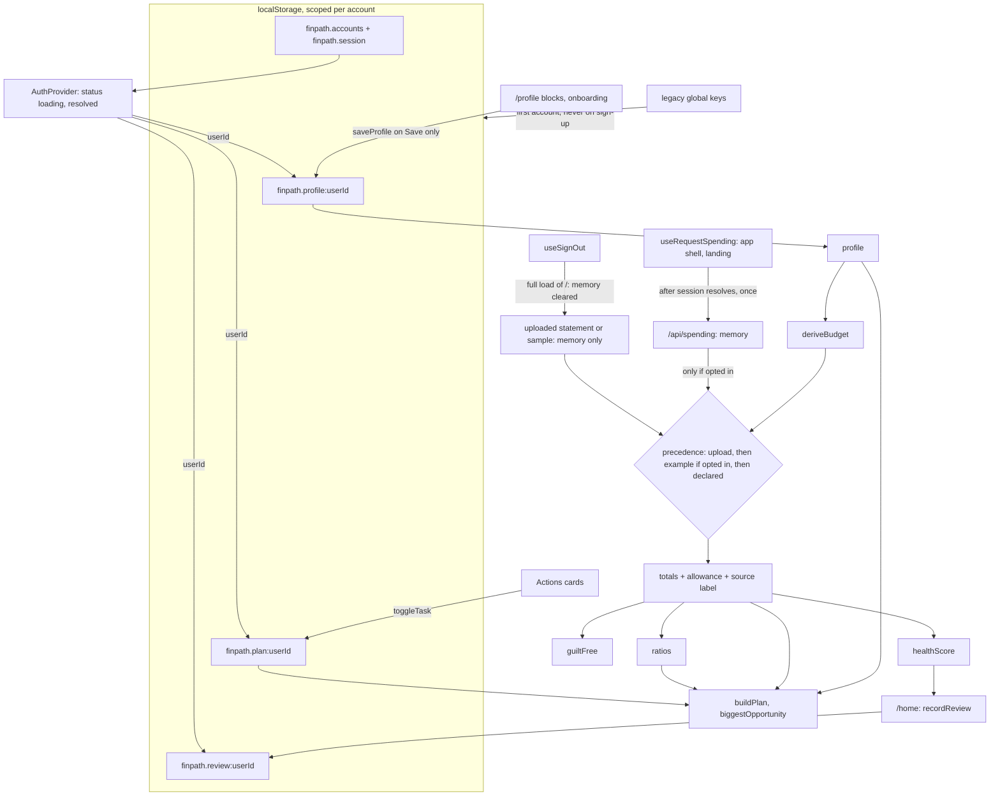
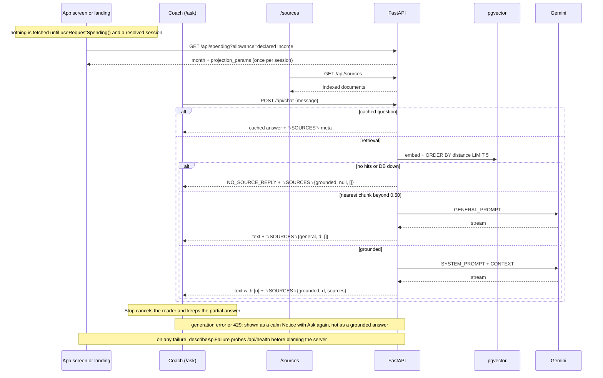

# Diagrams — FinPath after the editorial refactor (Phase 14)

Five Mermaid diagrams, drawn from the code at the end of the refactor. The "before" versions of the last three are in `01-audit.md` §5; the notes under each diagram say what changed.

1. [Repository workflow](#1-repository-workflow)
2. [User journey](#2-user-journey)
3. [Component dependency graph](#3-component-dependency-graph)
4. [State flow](#4-state-flow)
5. [API flow](#5-api-flow)

---

## 1. Repository workflow

How a change moves through the repo: the three deployables, the gate every phase passed, and the branch and commit shape the refactor used.

Each phase is two commits because a commit can't contain its own hash: the work first, then the progress entry that cites it. `git log --oneline --grep "ux(phase-"` lists both.

---

## 2. User journey

The path a student takes, with the one next step each screen offers.

Not drawn, to keep the lines readable:
- Every app route bounces to `/login?next=…` without a session, and `?next=` survives sign-up and onboarding.
- `/spending` can import a statement or load the sample in place.
- An Actions card ticks to Done with Undo.
- Every Sign out control does a full load of `/`.

**Changed since the audit's route diagram (§5.1):**
- Onboarding goes straight to Home; the Done screen is gone.
- The header search is gone; Home's Ask box prefills `/ask` without sending.
- Spending and What-if are reached from Home and Actions, not the nav.
- The legacy routes are 308, not 307.
- Every Sign out lands on `/`.

---

## 3. Component dependency graph

**Changed since audit §5.2:**
- The Tooltip and Toast providers moved from the root layout into the `(app)` shell.
- New: `ActionCard`, `Notice`, `SectionLabel`, `TrustLine`, `FooterAccount`, `useSignOut`, `useRequestSpending`, `lib/score`, `lib/action-meta`, `lib/account-storage`, `lib/safe-next`.
- `ScenarioChart` loads on demand.
- The barrel tree-shakes.

---

## 4. State flow

**Changed since audit §5.3:**
- Storage keys are per account, with a one-time migration.
- The example month is fetched only when a screen asks and the session has resolved.
- The sample file is labelled as its own source.
- Sign out reloads the page, so an uploaded statement can't survive into the next session in the same tab.

---

## 5. API flow

The backend is unchanged by the refactor; the diffstat for `backend/` since `main` is empty. What changed is which screens call it, and when.

**Changed since audit §5.4:** only the client side. `/api/spending` has left the auth pages and `/sources` and is called once per app screen instead of twice. Stop, the kept partial answer, and the calm failure notice (B-2, B-3) are frontend. The `␟SOURCES␟` contract is unchanged.
